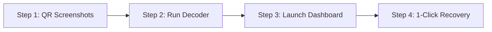

# ⚡ VORTEX SUITE — Master Operational Manual
> **GitBook / Notion Edition**  
> *Automated Recovery, Session Preservation & Anti-Detection System for 300–400 Inactive Google Accounts*  
> **Target Environment:** Windows 11 · ixBrowser · Real Android Physical Hardware · Jazz/Zong 4G Mobile Carrier

---

## 📑 Table of Contents
1. [Overview & Architecture](#1-overview--architecture)
2. [What Data You Need to Provide](#2-what-data-you-need-to-provide)
3. [Quick Start (3-Step Fast Track)](#3-quick-start-3-step-fast-track)
4. [Google Authenticator Bulk Import Guide](#4-google-authenticator-bulk-import-guide)
5. [How to Run & Use the System](#5-how-to-run--use-the-system)
6. [Troubleshooting & Issue Resolution](#6-troubleshooting--issue-resolution)
7. [Manual Fallback Procedures](#7-manual-fallback-procedures)
8. [Post-Recovery Safety & Email Warmup Rules](#8-post-recovery-safety--email-warmup-rules)

---

## 1. Overview & Architecture

VORTEX is a dual-lane hardware-in-the-loop (HIL) and anti-detect automation suite built specifically to recover dormant Google accounts blocked by Google's **FIDO2 / caBLE QR Code Challenge**.

```
                           ┌──────────────────────────────┐
                           │   VORTEX DASHBOARD (Web UI)  │
                           │     http://127.0.0.1:8765    │
                           └──────────────┬───────────────┘
                                          │
                  ┌───────────────────────┴───────────────────────┐
                  ▼                                               ▼
     ┌────────────────────────┐                     ┌────────────────────────┐
     │  LANE A: ixBrowser     │                     │  LANE B: Android Phone │
     │  (PC Profiles)         │                     │  (OnePlus / Tecno USB) │
     ├────────────────────────┤                     ├────────────────────────┤
     │ • Playwright CDP       │                     │ • Real GMS Hardware TEE│
     │ • Bypass QR via        │                     │ • Native Add-Account   │
     │   "Try Another Way"    │                     │ • 4G Carrier IP Toggle │
     │ • Waterfall Passwords  │                     │ • Live Screen Mirror   │
     │ • Live TOTP Injection  │                     │ • Safe Character Esc   │
     │ • Cloud Session Sync   │                     │ • Zero caBLE Challenge │
     └────────────────────────┘                     └────────────────────────┘
```

---

## 2. What Data You Need to Provide

Aapko sirf yeh basic cheezain provide karni hain. Inke ilawa koi cheez zaroori nahi:

### ✅ Data Checklist
| Data Asset | Format | Kahan Daalna Hai? | Purpose |
|---|---|---|---|
| **Google Authenticator QR Screenshots** | `.png` ya `.jpg` images | `qr_images/` folder mein | Saare 300 accounts ke 2FA keys bulk extract karne ke liye. |
| **Passwords Waterfall** | 3 se 4 candidate passwords | `config.json` | 80% / 15% / 5% passwords waterfall ke liye. |
| **Recovery Emails** | Email addresses | `config.json` | `abidmcs99@gmail.com` aur `abidmmp100@gmail.com` confirm challenges ke liye. |
| **Appeal Settings** | Contact email + message | `config.json` | Suspended accounts par auto-appeal submit karne ke liye. |
| **Registered SIM Cards** | Physical SIMs in phone | Phones mein active | Agar kisi account par SMS OTP aaye toh live code receive karne ke liye. |

---

## 3. Quick Start (3-Step Fast Track)

Agar aapko foran kaam shuru karna hai, toh yeh 3 steps karein:



### Step 1: Screenshots Le Kar Folder Mein Daalein
* Mobile par Google Authenticator kholein: `3 Dots / Settings > Transfer accounts > Export accounts`.
* Next karein, screen par QR aayega.
* **Next ➔ Screenshot ➔ Next ➔ Screenshot** karein (~25 screenshots banenge).
* Yeh saare screenshots apne PC ke is folder mein copy kar dein:  
  📁 `C:\Users\Ali\Desktop\gmail issue fix\qr_images\`

### Step 2: One-Click Decoder Run Karein
Terminal ya PowerShell mein sirf yeh run karein:
```powershell
cd "C:\Users\Ali\Desktop\gmail issue fix"
python decode_authenticator_qr.py
```
> **Nateeja:** 2 second ke andar saare 300 accounts decode ho kar `vault.db` aur `authenticator_extracted.csv` mein save ho jayenge!

### Step 3: Suite Launch Karein
Desktop par maujood batch file par double click karein:  
🚀 **`Launch_Suite.bat`**  
Ya terminal mein:
```powershell
python app.py
```
Browser mein Dashboard open ho jayega: **`http://127.0.0.1:8765`**

---

## 4. Google Authenticator Bulk Import Guide

### ❓ Sawal: "Kya 300 QR codes aayenge?"
**Nahi!** Google Authenticator ek single QR code ke andar **10 se 12 accounts** compress karke rakhta hai.  
Iska matlab 300 accounts ke sirf **25 se 30 QR codes** banenge.

### 📸 Screenshots Process (1 Minute Kaam):
1. Mobile par Authenticator kholein ➔ **Transfer accounts** ➔ **Export**.
2. Pehle 10-20 accounts select karein (test ke liye) ya **Select All** karein.
3. Pehle QR ka screenshot lein ➔ "Next" dabayein ➔ Doosre ka screenshot lein.
4. Phone ko PC se connect karein ya WhatsApp/Drive/Bluetooth ke zariye screenshots folder mein daal dein:  
   `c:\Users\Ali\Desktop\gmail issue fix\qr_images\`
5. Terminal mein `python decode_authenticator_qr.py` chalayein.
6. Script automatically saari images ko scan karegi:
   ```text
   [+] Found 28 screenshots in qr_images/ folder! Scanning...
     ✓ Found QR Code in: screenshot_01.png
     ✓ Found QR Code in: screenshot_02.png
     ...
   [+] SUCCESS! Successfully extracted total 312 accounts!
   [+] All accounts imported directly into Vortex Vault Database!
   ```

---

## 5. How to Run & Use the System

Aapke paas **Do Running Modes** hain:

### Mode 1: Web Dashboard (Recommended — Visual & Interactive)
1. Browser mein kholein: **`http://127.0.0.1:8765`**
2. Screen par 3 main hissay dikhenge:
   - **Left:** Real Android Phone Screen Mirror (USB connected phone ki live screen).
   - **Right:** Accounts Table with Live 2FA Codes (Har 30 second baad code rotate hota hai).
   - **Bottom:** Real-Time Terminal Console Logs.
3. Har account ke samne action buttons hain:
   - `📧 Email`: Active field mein email inject karta hai.
   - `🔑 Pass`: Waterfall password inject karta hai.
   - `🛡️ 2FA`: Live 30-second TOTP code calculate karke inject karta hai (expiry guard ke sath).
   - `🌐 ixBrowser Auto`: Automated background login trigger karta hai.

### Mode 2: Real Android Phone HIL Flow (No-QR Guaranteed)
Agar kisi account par PC mein bar bar QR code aa raha ho aur hat na raha ho:
1. Apna OnePlus 9 Pro ya Tecno Spark 5 Pro USB cable se lagayein (USB Debugging ON).
2. Dashboard par click karein: **`🚀 Launch Native No-QR Login`**.
3. Phone par native Android Add-Account screen khulegi.
4. "Google" par tap karein.
5. Dashboard se `📧 Email` ➔ `🔑 Pass` ➔ `🛡️ 2FA` click karein.
6. Phone native screen par kabhi bhi caBLE QR code nahi aata, direct login ho jata hai!

---

## 6. Troubleshooting & Issue Resolution

| Masla / Error | Wajah | Solution (Kaisay Solve Karein?) |
|---|---|---|
| **"You have scanned from this device too many times"** | Google Play Services hardware attestation rate-limit (3-4 accounts per 24h limit hit). | Dashboard par **`🧹 Reset GMS Quota`** dabayein aur **`🔄 Rotate 4G IP`** dabayein. Ya phone switch karein (OnePlus se Tecno par shift hon). |
| **"Wrong password" / Account lockout risk** | 1st password match nahi hua. | Script automatic **max 3 attempts** try karti hai. Agar 3 fail ho jayein toh account lock hone se pehle stop ho kar `WRONG_PASSWORD` mark kar deti hai. Password `config.json` mein verify karein. |
| **"Verify it's you" / SMS OTP Screen** | Google ne registered SIM par SMS OTP bheja. | Jis phone mein woh SIM lagi hai, SMS code check karein. Dashboard console mein prompt aayega, wahan code type karein. |
| **"Account disabled / Suspended"** | 90 din dormancy ki wajah se account flagged hai. | Bot automatic Google ke appeal form par contact email `abidmcs99@gmail.com` aur agency message daal kar appeal submit kar deta hai. |
| **"Device Disconnected" in mirror** | Phone USB debugging band hai ya cable loose hai. | Phone Settings ➔ Developer Options ➔ "USB Debugging" OFF karke dobara ON karein aur "Always allow from this computer" par tick karein. |
| **ixBrowser Offline badge** | ixBrowser app band hai ya API add-on inactive hai. | ixBrowser application open rakhein. Agar Free plan ho toh Mode 1 ke Hotkey/Extension method ya Dashboard 1-click injector use karein. |

---

## 7. Manual Fallback Procedures

Agar kabhi automated flow kisi tough security check par ruk jaye, toh ghabranay ki zaroorat nahi:

### Fallback 1: Manual Screen Click & Assist
- Dashboard ke left panel par live phone screen mirror dikh raha hota hai.
- Aap screen par direct click karke kisi bhi button ko tap kar sakte hain.
- Niche **◀ Back**, **● Home**, aur **✔ Enter** ke physical hardware buttons hain jinse aap phone control kar sakte hain.

### Fallback 2: Direct ixBrowser Manual Open with Live Codes
- ixBrowser mein profile manually open karein.
- Dashboard (`http://127.0.0.1:8765`) par us account ka **Live 6-digit TOTP code** samne chal raha hoga.
- Dashboard par code par click karein (auto-copy to clipboard) aur ixBrowser mein paste kar dein.

---

## 8. Post-Recovery Safety & Email Warmup Rules

> [!WARNING]
> **CRITICAL RULE:** Recover hone ke foran baad accounts ko Instantly ya Smartlead warmup mein mat daalein!

1. **48-Hour Quarantine / Cooldown Period:**  
   Account recover hone ke baad kam az kam **48 ghante** tak koi bulk marketing emails na bhejein. Google ka Socrates AI engine sudden IP shift (Pakistani Mobile ➔ US Datacenter) ko account hijacking samajh kar re-suspend kar deta hai.
2. **Batch Limit:**  
   Ek din mein ek phone se **10 se 15 accounts** se zyada recover na karein.
3. **Warmup Export:**  
   Dashboard par **`⬇ Export for Warmup`** button dabane se CSV file download hogi jo directly Instantly/Smartlead format mein formatted hoti hai.

---

*VORTEX Suite is fully built and deployed locally in:*  
`C:\Users\Ali\Desktop\gmail issue fix\`  
*To launch at any time, run:* **`Launch_Suite.bat`**
